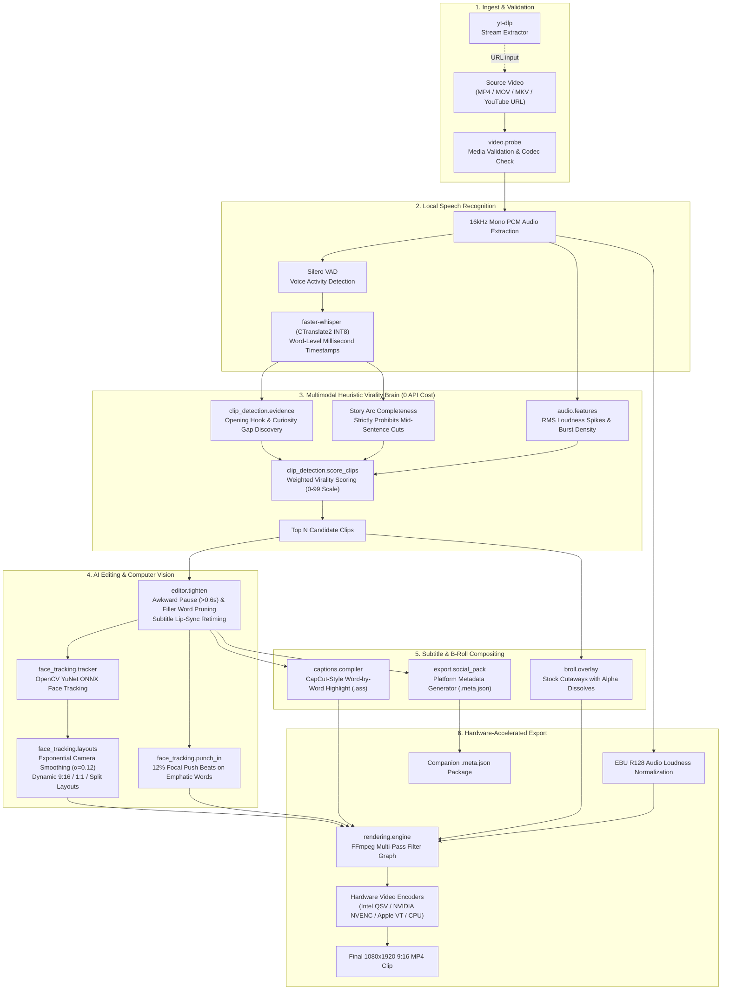
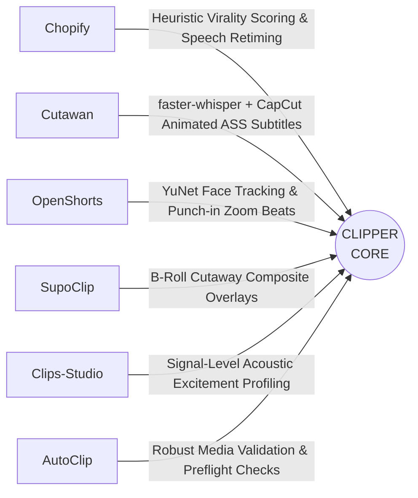

# 🎬 Clipper: Autonomous AI Video Processing & Viral Clipping Engine

<div align="center">

> **"One Long Video. Multiple Viral Stories. Powered by 100% Local AI."**

[](https://www.python.org/)
[-success.svg)](#-zero-api-cost-architecture)
[](#-hardware-accelerated-rendering)
[-brightgreen.svg)](#-testing--quality-assurance)
[](THIRD_PARTY_NOTICES.md)

</div>

**Clipper** is an autonomous, lightweight, and modular AI Video Processing Environment and Agent Skill. It transforms long-form footage (podcasts, gaming streams, interviews, educational lectures, webinars, talking-head videos) into publication-ready viral short-form clips (**YouTube Shorts, Instagram Reels, TikTok, Square 1:1, Landscape highlights**).

Clipper operates **100% locally and offline with zero paid API dependencies** (no OpenAI, Claude, or Groq API keys required), consolidating the best algorithms from six open-source repositories: **Chopify**, **Cutawan**, **OpenShorts**, **SupoClip**, **Clips-Studio**, and **AutoClip**.

---

## 📐 System Architecture

The following diagram illustrates how video frames, audio signals, and transcripts flow through Clipper's unified pipeline:



---

## ⚡ Key Capabilities & Repository Heritage

Clipper brings together the strongest features from six proven video processing repositories:



| Source Repo | Feature Integrated | Technical Benefit in Clipper |
| :--- | :--- | :--- |
| **Chopify** | Heuristic Scoring & Tightening | **0 API cost**: Evaluates hooks, questions, and narrative completion without calling OpenAI or external LLMs. |
| **Cutawan** | Faster-Whisper & ASS Karaoke | **Local transcription**: Word-level timestamps via CTranslate2. Animated subtitles with viral typography (Anton, Poppins, Montserrat). |
| **OpenShorts** | YuNet Face Tracking & Punch-In | **Dynamic 9:16 Reframe**: Exponential camera trajectory smoothing ($\alpha = 0.12$) and $12\%$ punch-in zoom on high-emphasis words. |
| **SupoClip** | B-Roll Cutaway Overlays | **Viewer retention**: Dissolves stock footage over the speaker without black cuts; subtitles remain visible on top. |
| **Clips-Studio**| Audio Excitement Signals | **Hype moment detection**: Uses NumPy signal processing to find volume spikes, laughter, and cheers in seconds. |
| **AutoClip** | Stream Probing & Preflight | **Zero crashes**: Validates codecs, aspect ratios, and corrupt containers before rendering starts. |

---

## 🧠 Multimodal Virality Scoring Algorithm

Clipper evaluates potential clips without expensive API calls using a multimodal scoring formula:

$$\text{Virality Score} = (S_{\text{hook}} \times 0.35) + (S_{\text{energy}} \times 0.25) + (S_{\text{story}} \times 0.25) + (S_{\text{audio}} \times 0.15)$$

- **Hook Strength ($S_{\text{hook}}$):** Analyzes the first 3–5 seconds for question patterns (`"Why do..."`, `"Have you noticed..."`), curiosity gaps (`"The secret..."`, `"Nobody talks about..."`), and shocking statements.
- **Speech Energy ($S_{\text{energy}}$):** Calculates Words Per Second (WPS) to ensure clips have engaging pacing.
- **Story Completeness ($S_{\text{story}}$):** Detects punctuation boundaries to ensure sentences are never cut in the middle.
- **Acoustic Excitement ($S_{\text{audio}}$):** Identifies sudden volume spikes ($>2\times$ over rolling 30s median) and high onset bursts (laughter, cheers).

---

## 📁 Repository Structure

```
.
├── src/
│   ├── cli.py                    # Master CLI tool & autonomous execution engine
│   ├── config.py                 # Cross-platform config, binary discovery, GPU detection
│   ├── audio/                    # Acoustic excitement & energy analysis (Clips-Studio)
│   │   └── features.py           # RMS loudness, rolling median spikes, burst density
│   ├── broll/                    # B-Roll cutaways with alpha dissolves (SupoClip)
│   │   └── overlay.py            # FFmpeg filtergraph cutaway compositing
│   ├── captions/                 # Animated ASS karaoke subtitles (Cutawan)
│   │   ├── compiler.py           # Word-by-word active highlight generator
│   │   ├── styles.py             # Viral color presets (viral_yellow, clean_cyan, etc.)
│   │   └── srt.py                # Standard SRT exporter
│   ├── clip_detection/           # Heuristic virality scoring brain (Chopify)
│   │   ├── score_clips.py        # Candidate ranking and story arc solver
│   │   ├── evidence.py           # Lexical pattern matcher and hook detector
│   │   └── visual.py             # Visual scene motion analysis
│   ├── editor/                   # Declarative edit planning & speech tightening
│   │   ├── edit_plan.py          # Universal JSON editing plan builder
│   │   └── tighten.py            # Filler word and silence trimmer with retiming
│   ├── export/                   # Social media viral packaging
│   │   ├── social_pack.py        # Title, hook, description, and hashtag generator
│   │   └── presets.py            # Platform-specific presets (Shorts, TikTok, Reels)
│   ├── face_tracking/            # YuNet face tracking & punch-in directing (OpenShorts)
│   │   ├── tracker.py            # OpenCV YuNet ONNX detector & smoothed camera
│   │   ├── punch_in.py           # Smoothstep focal zoom beats on emphasis words
│   │   └── layouts.py            # Single speaker, split reaction, camera inset
│   ├── rendering/                # Hardware-accelerated GPU export
│   │   ├── engine.py             # FFmpeg multi-pass filter execution
│   │   └── encoders.py           # QSV, NVENC, VideoToolbox, and libx264 configurations
│   ├── transcription/            # Speech-to-Text engine (Cutawan)
│   │   └── engine.py             # faster-whisper + Silero VAD + direct PCM buffer
│   └── video/                    # Video probing, validation & scene detection (AutoClip)
│       ├── probe.py              # FFprobe stream metadata and container validator
│       └── scene.py              # Visual scene cut detector
│
├── skills/
│   └── ai-video-clipping/
│       └── SKILL.md              # Antigravity autonomous agent skill runbook
│
├── resources/
│   ├── bin/                      # Multimedia binary placeholder / auto-discovery
│   ├── fonts/                    # Bundled viral fonts (Anton, Poppins, Montserrat)
│   └── models/                   # Local neural weights (YuNet ONNX, Silero VAD ONNX)
│
├── tests/                        # Full automated test suite (27 passing tests)
├── requirements.txt              # Minimal Python dependencies
├── pyproject.toml                # Standard package configuration
├── README.md                     # This documentation
└── THIRD_PARTY_NOTICES.md        # Open-source attributions & licenses
```

---

## 🚀 Quickstart & Installation

### 1. Clone the Repository
```bash
git clone https://github.com/di7xu/Clipper.git
cd Clipper
```

### 2. Install Python Dependencies
```bash
pip install -r requirements.txt
```

### 3. Ensure FFmpeg is Installed
Clipper auto-discovers FFmpeg from system PATH:
```bash
# Windows (winget)
winget install Gyan.FFmpeg

# Ubuntu / Debian
sudo apt-get install ffmpeg

# macOS (Homebrew)
brew install ffmpeg
```

---

## 💻 CLI Usage

### A. Extract Top 3 Viral Shorts from a Local Video
```powershell
python src/cli.py -i "interview.mp4" -o "output_clips" -n 3 --aspect 9:16 --style viral_yellow
```

### B. Clip Directly from a YouTube / Web URL
```powershell
python src/cli.py -u "https://www.youtube.com/watch?v=VIDEO_ID" -o "output_clips" -n 3
```

### C. Composite Stock B-Roll Cutaways
```powershell
python src/cli.py -i "talking_head.mp4" -b "stock_footage.mp4" -o "output_clips" -n 3
```

### D. Custom Aspect Ratio & Platform Preset
```powershell
python src/cli.py -i "podcast.mp4" -o "reels_output" -n 5 --aspect 9:16 --platform instagram_reels --style clean_cyan
```

---

## ⚙️ CLI Options & Parameters

| Flag | Long Option | Allowed Values | Default | Description |
| :--- | :--- | :--- | :--- | :--- |
| `-i` | `--input` | File path | None | Source video file path (MP4, MOV, MKV, etc.) |
| `-u` | `--url` | Web URL | None | Public video URL to download and process |
| `-o` | `--output` | Directory path | `output_clips/` | Destination folder for rendered MP4 clips & metadata |
| `-n` | `--count` | Integer | `3` | Number of top viral clips to extract and render |
| `-a` | `--aspect` | `9:16`, `1:1`, `16:9` | `9:16` | Target video aspect ratio |
| `-s` | `--style` | `viral_yellow`, `clean_cyan`, `bold_coral`, `minimal_white` | `viral_yellow` | Animated karaoke subtitle style |
| `-m` | `--model` | `tiny`, `base`, `small`, `medium` | `base` | Local `faster-whisper` model size |
| `-p` | `--platform` | `youtube_shorts`, `tiktok`, `instagram_reels` | `youtube_shorts` | Social media metadata targeting |
| `-b` | `--broll` | File path | None | Optional stock B-roll cutaway video file to overlay |
| | `--no-tighten`| Flag | False | Disable automatic filler word and silence trimming |
| | `--no-captions`| Flag | False | Disable burned-in animated karaoke subtitles |

---

## 🧪 Testing & Quality Assurance

Clipper includes a thorough automated test suite covering all modules:

```powershell
python -m pytest -v
```

**Results:**
```
============================= 27 passed in 31.91s =============================
tests/test_audio_features.py::test_rolling_median PASSED                 [  3%]
tests/test_broll.py::test_broll_normalization_and_timing PASSED          [  7%]
tests/test_broll.py::test_broll_filter_graph_generation PASSED           [ 11%]
tests/test_captions.py::test_time_formatters PASSED                      [ 14%]
tests/test_captions.py::test_chunk_words PASSED                          [ 18%]
tests/test_captions.py::test_compile_ass_subtitles PASSED                [ 22%]
tests/test_captions.py::test_export_srt PASSED                           [ 25%]
tests/test_captions.py::test_hex_to_ass_color PASSED                     [ 29%]
tests/test_clip_scoring.py::test_sentenceize PASSED                      [ 33%]
tests/test_clip_scoring.py::test_clip_scorer_candidates PASSED           [ 37%]
tests/test_e2e_full_workflow.py::test_full_pipeline_e2e PASSED           [ 40%]
tests/test_editor.py::test_clean_token PASSED                            [ 44%]
tests/test_editor.py::test_tighten_filler_words PASSED                   [ 48%]
tests/test_editor.py::test_tighten_silence_removal PASSED                [ 51%]
tests/test_editor.py::test_create_edit_plan PASSED                       [ 55%]
tests/test_face_tracking.py::test_smoothed_camera PASSED                 [ 59%]
tests/test_face_tracking.py::test_crop_window_aspect_ratios PASSED       [ 62%]
tests/test_face_tracking.py::test_plan_punch_in_beats PASSED             [ 66%]
tests/test_face_tracking.py::test_split_and_inset_filtergraphs PASSED    [ 70%]
tests/test_rendering.py::test_encoder_args PASSED                        [ 74%]
tests/test_rendering.py::test_social_metadata_and_package PASSED         [ 77%]
tests/test_rendering.py::test_end_to_end_render PASSED                   [ 81%]
tests/test_transcription.py::test_extract_audio PASSED                   [ 85%]
tests/test_transcription.py::test_whisper_model_initialization PASSED    [ 88%]
tests/test_video_probe.py::test_parse_frame_rate PASSED                  [ 92%]
tests/test_video_probe.py::test_validate_media_file PASSED               [ 96%]
tests/test_video_probe.py::test_probe_video PASSED                       [100%]
```

---

## 📜 Third-Party Licenses & Attribution

Clipper honors and preserves all licenses from its source repositories:
- **Chopify** (MIT License) - Copyright (c) 2024 mehbul
- **Cutawan** (MIT License) - Copyright (c) 2024 JeremySNR
- **OpenShorts** (AGPL-3.0 License) - Copyright (c) 2024 mutonby
- **SupoClip** (MIT License) - Copyright (c) 2024 FujiwaraChoki
- **Clips-Studio** (MIT License) - Copyright (c) 2024 ColinGPT9
- **AutoClip** (MIT License) - Copyright (c) 2024 zhouxiaoka
- **YuNet Face Detection** (Apache 2.0 License) - OpenCV Team
- **Silero VAD** (MIT License) - Silero Team
- **Fonts** (SIL Open Font License) - Anton, Archivo Black, Montserrat, Poppins

Complete details can be found in [THIRD_PARTY_NOTICES.md](THIRD_PARTY_NOTICES.md) and [LICENSE_AUDIT.md](LICENSE_AUDIT.md).
